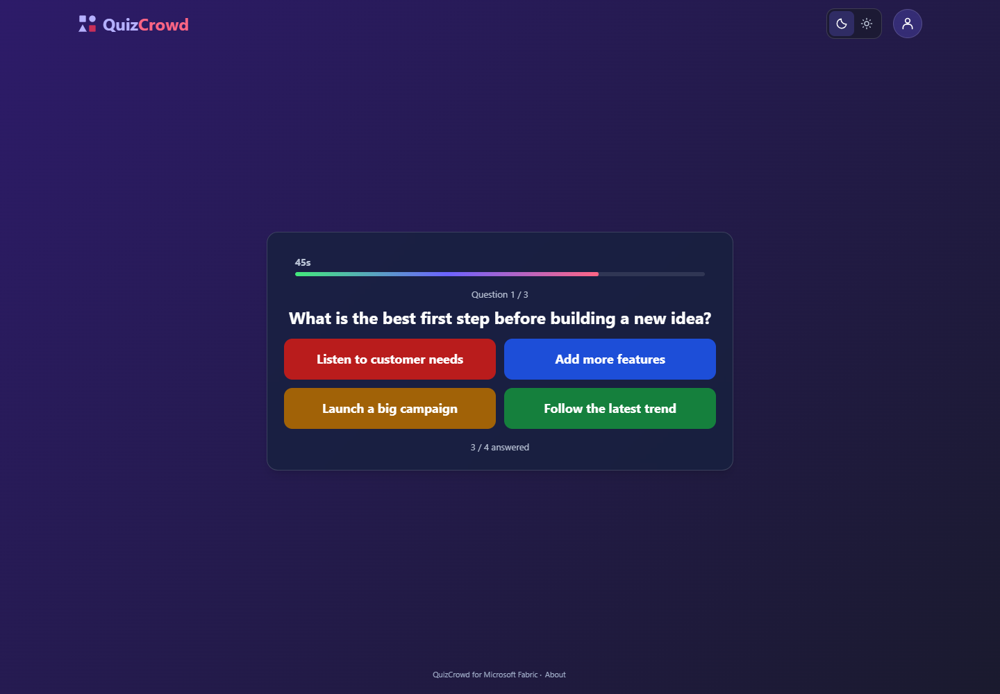
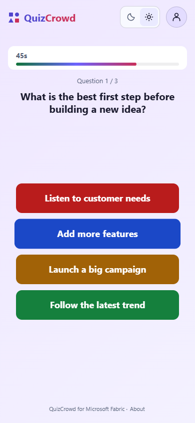
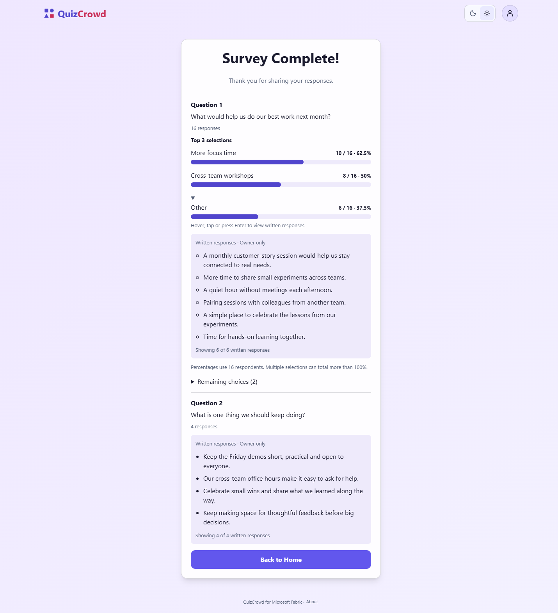
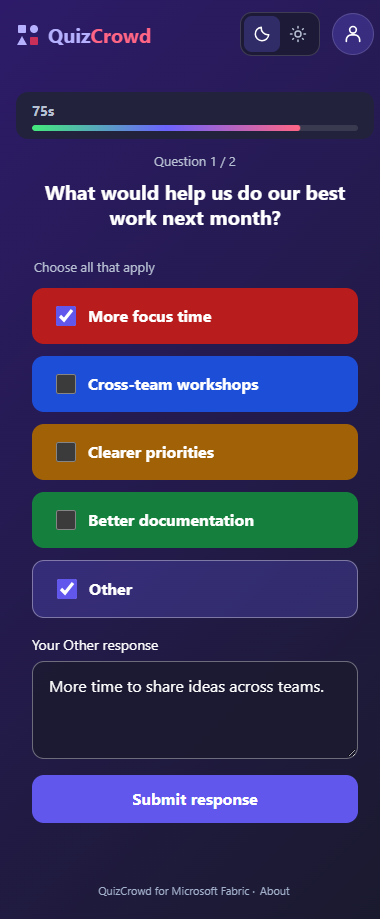
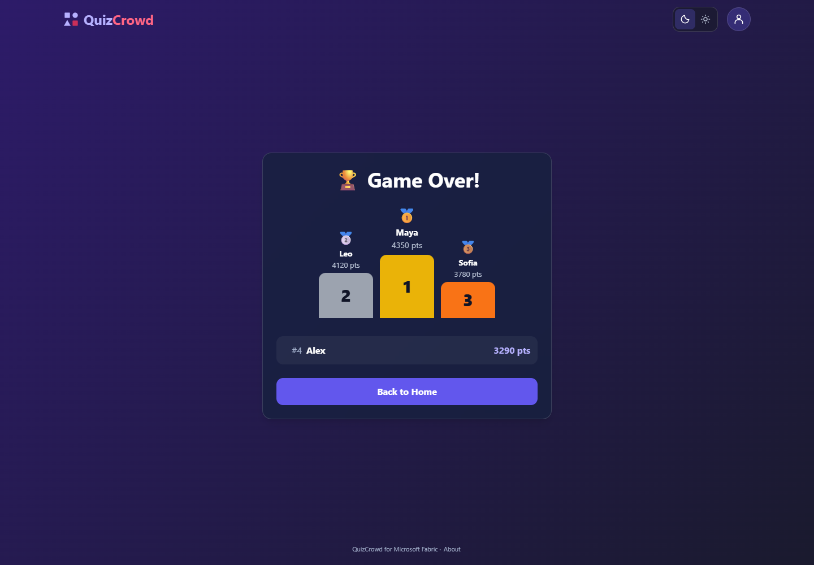

# QuizCrowd for Microsoft Fabric

Live quizzes and manually authored surveys, with Microsoft Entra sign-in,
publisher-controlled anonymous attendance, and application data persisted in
**SQL Database in Microsoft Fabric**.

> **Preview implementation template, not a production-certified deployment.**
> Local typechecks, game/authorization tests and the real Fabric Functions
> bundler are exercised. The latest validation passed 188 local tests,
> focused real-browser theme checks in addition to the earlier 120-scenario
> isolated-fixture UI baseline, and 25 recorded live
> SDK check groups against an existing Fabric deployment. See the
> [validation scope and limits](docs/deployment.md#november-11-2026-publication-and-install-validation).
> In particular, anonymous Function invocation with app-identity SQL access
> must be confirmed in your tenant before enabling public attendance.
> A live public-hosting experiment served the frontend anonymously, but
> Function calls still returned HTTP 403; public assets alone did not unblock them.
> See the [release gates](docs/deployment.md#release-gates).

## What you can build

| Experience | Included |
| --- | --- |
| Creator | Compact clickable session cards, branded two-column editor, shared/per-question answer durations, immutable content type, server-enforced read-only view, fresh private duplicate, confirmed owner-only delete |
| Host | Lobby, QR invite, six-digit numeric game code, start/next controls, timed questions, reveal and leaderboard |
| Attendee | Entra sign-in; per-tab secret attendee credential; guest protocol implemented but current unsigned Fabric gateway remains blocked |
| Game | Server-calculated scores (1,000 + up to 500 speed points), streaks, late-join policy, three answer-reveal policies |
| Survey | Single/multiple selections, Other and free text; host-only top-three charts and written feedback; no scoring or AI generation |
| Publisher | Explicit administrator bootstrap, audited database guest-access switch, revocation of existing guest sessions |
| Persistence | Settings, quizzes, questions, options, keys, participants, submissions, scores and game phases in private Fabric SQL |

### Secure by default

Anonymous access starts **off**. Each new quiz starts **Internal Only**.
Selecting **Anyone (Public)** requires explicit acknowledgement:

> Anyone (Public) makes all questions and response options accessible to anyone
> with the quiz URL, including before the game starts. Answer keys, individual
> responses and personal data are not included.

The global database switch is enforced on every guest preview, join, state read
and response submission, not just in the UI. Turning it off revokes subsequent
guest operations after already-running transactions complete. Re-enabling does
not revive old guest credentials. Downloaded public content cannot be recalled.
Creators can make a running quiz internal independently of the global switch.

There is **no anonymous SQL login**, password-based admin account, self-assigned
admin role, or public quiz CRUD endpoint. Only a small identity entity is exposed
through Rayfin's data service; its actual generated policy restricts reads and
creates to the authenticated subject. All application data uses the private
Function/SQL boundary. Read the [architecture](docs/architecture.md).

## Use this template

1. Select **Use this template > Create a new repository** on
   [mustafaasiroglu/quizcrowd-fabric](https://github.com/mustafaasiroglu/quizcrowd-fabric).
   Review [licensing status](LICENSING.md) before redistribution.
2. Clone your new repository and install **Node.js 24 LTS**.
3. Run `npm ci --ignore-scripts --no-audit`, then `npm run check`.

### Deploy in three steps

1. **Create an App in a Fabric workspace** already assigned to your selected,
   approved capacity. Note its exact name and workspace ID.
2. **Deploy from VS Code/the project terminal.** Sign Azure CLI and Rayfin in as
   the same trusted publisher, then run:

   ```powershell
   az login
   npx rayfin login
   npm run deploy -- --workspace-id "<workspace-GUID>" --item-name "<App name>" --create-database --bootstrap-admin-self
   ```

   The deploy command runs the pinned Rayfin CLI, automatically creates a
   separate private **Fabric SQL Database**, initializes its schema, verifies
   your app identity before explicit admin bootstrap, configures encrypted
   server-side SQL coordinates, and performs a full `rayfin up` publication.
   `--create-database` explicitly approves SQL capacity/storage consumption;
   there is no separate manual database-creation step.
3. **Test the App inside Fabric.** Open the same App item in its workspace.
   Complete the [release gates](docs/deployment.md#release-gates) before sharing.

See [deployment details and existing-app upgrades](docs/deployment.md#three-step-install).
An existing app must initially use `--database-id "<existing-private-SQL-ID>"`
instead of `--create-database`; reruns reuse the ignored local binding. Existing
data, settings and administrator identities are preserved. No new capacity,
tenant policy or SQL access grants are created. The deployment identity must
already be authorized as the app owner/database administrator.

**Anonymous attendance is not yet a verified deployable feature.** The current
Fabric Functions gateway rejects unsigned invocation even when the database
guest switch is enabled. Automatic SQL setup and publication do not remove that
platform gate; do not enable public attendance until the anonymous release gate
is satisfied. The [bounded native SQL investigation](docs/anonymous-attendance.md)
explains the remaining response-authorization requirement and approval-dependent
alternative.

## Local commands

```powershell
npm ci --ignore-scripts --no-audit
npm run check
npm run dev:frontend
```

The frontend displays a clear configuration error until you supply a real
backend configuration. There is deliberately no in-memory demo backend masquerading
as persistence. Copy [the environment example](packages/frontend/.env.example)
for local frontend development against a deployed test backend.

For the full local Functions loop, install Azure Functions Core Tools v4,
configure a test Fabric environment, sign in with `npx rayfin login`, and run
`npm run dev`. The [deployment guide](docs/deployment.md) explains the identity
difference between local and deployed external connections.

| Command | Purpose |
| --- | --- |
| `npm run typecheck` | Strict frontend, shared, model and Function typechecks |
| `npm test` | Domain/service authorization, actual SDK metadata and mocked-HTTP SDK wire tests |
| `npm run build` | Local production frontend plus server/model compilation; no cloud writes |
| `npm run check` | Typecheck, tests and build |
| `npm audit --audit-level=high` | Full online dependency audit; also enforced in CI |
| `npm run dev:frontend` | Loopback-only Vite frontend |
| `npm run dev` | Rayfin frontend + local Function development (requires configured environment) |
| `npm run deploy -- --workspace-id "<GUID>" --item-name "<App>" --create-database --bootstrap-admin-self` | Automatic private SQL installation and full existing-App publication |
| `npx rayfin functions init --path rayfin/functions` | Regenerate Function types; preserves existing implementation |
| `npx rayfin up --workspace "<workspace-name>"` | Advanced: publish Fabric services only; does not initialize the separate private application SQL database |

## Project layout

```text
packages/frontend/       React/Vite application and Entra sign-in
packages/shared/         Public contracts and warning text
packages/data/           CallerIdentity entity only, protected with claims.sub
rayfin/functions/        Authorization, game rules, SQL persistence and Function
database/001-schema.sql  Standalone Fabric SQL application tables, guest access off
database/002-six-digit-codes.sql  Non-destructive numeric-code migration with legacy aliases
scripts/deploy.mjs       Explicit workspace/App deployment and private SQL bootstrap
docs/                   Deployment, admin operations, architecture and limitations
tests/                  Local regression and authorization tests
```

## QuizCrowd authoring, dark and light

### Sample screens

These are real browser captures of the application using **synthetic local
examples**, not live Fabric test evidence. Names, scores and feedback are
fictional. Survey results and written feedback appear only to the session owner;
attendees see their own response acknowledgement and a completion message.

| Desktop host | Mobile attendee |
| --- | --- |
|  |  |
|  |  |



The showcase uses explicit 60/90-second sample timings; **new drafts default to
15 seconds**. See [UI testing and capture instructions](docs/ui.md#polished-showcase).

Home offers **New Live Quiz**, **New Live Survey** and **Join with Code** above
recent session cards. The editor places title/questions on the left and settings
on the right, stacked on mobile. Started sessions or sessions with any submitted
answer open read-only, including through the server API. Compact cards omit
thumbnails and show sentence-case status, an accessible date icon, question count
and actual question-submission count. Home is the only session-list surface.
Purple/indigo and pink brand accents replace the previous teal interpretation.
Content type is fixed by the creation action, including on server updates.
Answer duration defaults to **Same for all**, set once in the settings panel.
**Customize per question** exposes a duration at each question. The selected mode
and remembered shared seconds persist in the existing game JSON, so custom stays
selected even when question times happen to match. Only older content without
the setting infers an initial mode from its question durations. Effective
question durations still drive game timers/scoring. A duplicate starts a new private
lobby without activity, with a new ID/code and **Copy - ** title, before opening
the copy's editor; the original stays unchanged. Survey questions support
Single Select, Multiple Select (optional Other), and Free Text using the existing
question JSON and answer encoding, without a database migration.
Six-digit codes preserve leading zeros; existing UUID
invitations and old codes remain compatible through server-side resolution.
The original QR lobby, colorful answers, leaderboard and podium remain.
The first visit follows the browser's light/dark preference; manual **Light**
and **Dark** choices take priority and are saved across
navigation and reloads. Entra, SQL-backed persistence, trusted publisher controls
and the Internal/Public authorization boundary remain.
See [UI behavior and screenshot review](docs/ui.md) for intentional
accessibility differences, local browser tests and exact capture paths.

## Status and limitations

The implementation uses the actual **Rayfin 1.36.2** packages and CLI, with a
committed npm lockfile. Tests with serialized in-memory *test doubles* are not
proof of live DAB authorization or SQL locking. The offline deployment bundle
contained 9.8 MB of bundled source (2.3 MB compressed) in the latest release,
below the documented 30 MB Function ZIP ceiling.

The UI and server support two to ten normal choices per question. Surveys also
support Other and text-only questions. Limits are 40 questions, 500 attendees per game, 5–120-second questions,
and 12-hour attendee credentials. One locked SQL aggregate per game favors
correctness over high-throughput scale; load-test your capacity before an event.
Image upload, AI survey generation, automatic retention, moderator tools and
custom domains are not implemented. See the [full operational limitations](docs/architecture.md#limitations).

The [public CI workflow](https://github.com/mustafaasiroglu/quizcrowd-fabric/actions/workflows/check.yml)
runs a clean install, the local regression tests, typechecks/build and a full
online dependency audit. The validated lockfile reported **0 known
vulnerabilities**; CI retains a
high/critical advisory gate. The lockfile uses patched Vite/Vitest plus explicit
Zod, CLI MSAL and glob overrides; see [dependency maintenance](docs/deployment.md#dependency-maintenance).
This is a point-in-time audit, not a security certification. Never use
`npm audit fix --force` to silently downgrade the verified Fabric SDK.

The production-build QR regression reproduces the duplicate-React hook failure
found during live testing. Vite explicitly deduplicates React for workspace
dependencies; the corrected QR/lobby and timed host UI were redeployed and
retested. Live tests used one real Entra account; foreign-owner and existing-guest
negative cases used trusted SQL fixtures. Public anonymous execution remains a
separate, unpassed release gate; see the [observed results](docs/deployment.md#release-gates).
Subsequent UI builds were published to the protected test app. New UI checks
use local browser fixtures, not a fresh authenticated live browser session.

## Attribution and distribution

Based on the original [QuizCrowd](https://github.com/mustafaasiroglu/QuizCrowd)
by Mustafa Asiroglu, reimplemented for static Fabric hosting instead of Next.js
server routes and in-memory state. Microsoft's official Universal App scaffold
provided the initial workspace structure.

**A project license still needs an owner decision.** The original QuizCrowd had
no LICENSE; this adaptation does not silently assign one. Microsoft's scaffold
notice is preserved separately. Read [LICENSING.md](LICENSING.md).
